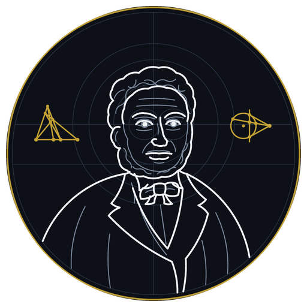
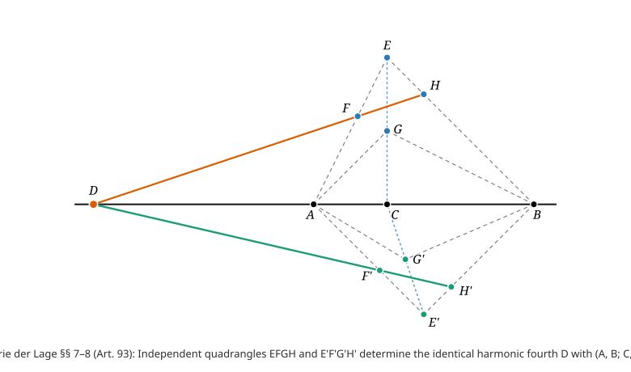

GEOMETOR • staudt
=================

**Visit the Online Archive:** https://geometor.github.io/staudt/

**Karl Georg Christian von Staudt • Geometrie der Lage, Beiträge zur Geometrie der Lage • semantic digital archive**

Mission
-------

``geometor/staudt`` is part of the interconnected `GEOMETOR <https://geometor.com>`_ semantic digital archive. Karl Georg Christian von Staudt founded modern synthetic projective geometry by liberating projective relations and the harmonic quadrangle from metric distance, angles, and coordinates, crowning his work with the pure straightedge Algebra of Throws (*Rechnung mit Würfen*). Within this archive, Staudt's foundational treatises are liberated from isolated print bounds into addressable semantic units, synchronized bilingual codices, calibrated theme-adaptive vector diagrams, and exact symbolic straightedge algorithms across the GEOMETOR corpus.

Books in This Archive
---------------------

- `Geometry of Position <https://geometor.github.io/staudt/geometrie_der_lage/>`_ — *Geometrie der Lage* (Karl Georg Christian von Staudt, 1847), establishing harmonic conjugates purely via the complete quadrangle, the Fundamental Theorem of Projective Geometry, and conics as polarities without distance or circles.
- `Contributions to the Geometry of Position <https://geometor.github.io/staudt/beitraege_1857/>`_ — *Beiträge zur Geometrie der Lage* (Zweites Heft: Die Rechnung mit Würfen, 1857), constructing projective addition and multiplication of throws purely with an unmarked straightedge to recover field arithmetic directly from incidence.

Repository Contents
-------------------

- ``docsrc/`` — 4-track synchronized Book Codex tracks, concordance, glossary, and scholarly apparatus compiled by `PHOTON publish <https://github.com/photon-platform/publish>`_.
- ``resources/`` — Verified primary source German texts, figures, and citation registries.
- ``src/geometor/staudt/`` — Exact straightedge-only symbolic geometry engine, harmonic fourth solver, and throw arithmetic routines.

Local Build & Verification
--------------------------

.. code-block:: bash

   publish build
   uv run --no-sync pytest

Part of the GEOMETOR Knowledge Archive
--------------------------------------

Explore all **74 Book Codices** and **11 Mathematical Catalogs** at https://geometor.com/books/.
