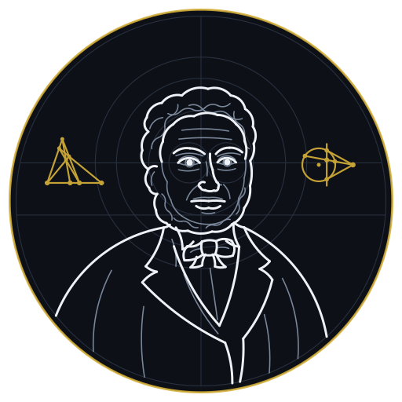

:site_title: Karl Georg Christian von Staudt

.. container:: author-overline

   semantic digital archive • the works of

===============================
Karl Georg Christian von Staudt
===============================

**Karl Georg Christian von Staudt** (1798–1867) achieved one of the boldest purifications in the history of mathematics: stripping projective geometry of every trace of distance, angle, and coordinates. Using only incidence and the complete quadrangle, he defined harmonic separation, proved the Fundamental Theorem of Projective Geometry, and erected his *Rechnung mit Würfen*—the Algebra of Throws—to recover field arithmetic from an unmarked straightedge alone. This archive presents both his 1847 and 1857 treatises in synchronized four-track editions.

Books in This Collection
------------------------

.. container:: home-book-hero

   .. container:: home-book-thumb plate-light

      .. image:: _static/figures/unit2_complete_quadrangle_harmonic.svg
         :alt: Complete Quadrangle Harmonic Fourth and Desarguesian Uniqueness
         :target: geometrie_der_lage/index.html

   .. container:: home-book-body

      .. rubric:: Nuremberg · 1847 · 12 Sections · 4 Synchronized Tracks

      **Geometry of Position (*Geometrie der Lage*)** — Staudt's foundational 1847 treatise rebuilding projective geometry from pure incidence: ideal elements, complete-quadrangle harmonic conjugates, the Fundamental Theorem of Projective Geometry, and conics as polarities without measurement.

      .. container:: home-actions

         * :doc:`Open Geometry of Position → <geometrie_der_lage/index>`
         * :doc:`Vorwort (Preface) → <geometrie_der_lage/vorwort/index>`
         * :doc:`§ 8 Fundamental Theorem → <geometrie_der_lage/sec_08/index>`

.. container:: home-book-hero

   .. container:: home-book-thumb plate-light

      .. image:: _static/figures/unit4_addition_of_throws.svg
         :alt: Pure Straightedge Addition of Throws on a projective line
         :target: beitraege_1857/index.html

   .. container:: home-book-body

      .. rubric:: Nuremberg · 1857 · Zweites Heft · 4 Synchronized Tracks

      **Contributions to the Geometry of Position (*Beiträge zur Geometrie der Lage*)** — Staudt's 1857 sequel introducing *throws* (*Würfe*) and constructing straightedge addition and multiplication directly on a projective carrier, establishing intrinsic projective coordinates prior to Hilbert.

      .. container:: home-actions

         * :doc:`Open Contributions (1857) → <beitraege_1857/index>`
         * :doc:`§ 19 Addition of Throws → <beitraege_1857/sec_19/index>`
         * :doc:`§ 20 Multiplication of Throws → <beitraege_1857/sec_20/index>`

Key Features
------------

.. container:: home-feature-grid

   .. container:: home-feature-card

      **Four Synchronized Tracks**

      Read Staudt's German primary text alongside a faithful English translation, concise analytical summaries, and scholarly concordance notes on every section.

   .. container:: home-feature-card

      **Metric-Free Straightedge Figures**

      Calibrated vector plates trace ideal sheaves, complete quadrangles, self-conjugate polarities, and straightedge throw addition and multiplication.

   .. container:: home-feature-card

      **Symbolic Throw Arithmetic**

      Executable Python modules and :doc:`Demos <demos/index>` implement Staudt's harmonic fourth solver and exact throw calculus over ``geometor.staudt``.

Reference & Project
-------------------

.. container:: home-columns

   .. container:: home-col

      .. rubric:: Scholarly Apparatus

      * :doc:`People <people/index>` — Profiles of von Staudt, Poncelet, Möbius, Steiner, Hilbert, and Pasch
      * :doc:`Bibliography <bibliography>` & :doc:`Concordance <concordance>` — Primary Nuremberg editions and cross-corpus links
      * :doc:`Glossary <glossary>` — German/English terminology of *Grundgebilde*, *Würfe*, and polarities

   .. container:: home-col

      .. rubric:: About This Project

      * :doc:`About <about/index>` & :doc:`Using This Edition <usage/index>` — Editorial scope, 4-track layout, and reading guide
      * :doc:`Demos <demos/index>` & :doc:`Python Modules <modules/index>` — Straightedge algorithms and symbolic tests
      * :doc:`Project Log <log/index>` — Development notes and codex milestones

.. toctree::
   :maxdepth: 2
   :hidden:

   geometrie_der_lage/index
   beitraege_1857/index
   people/index
   bibliography
   glossary
   concordance
   about/index
   usage/index
   demos/index
   log/index
   modules/index
